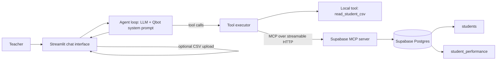

# Qbot

Qbot is an AI learner-guidance agent for teachers in African schools. It reads a learner's profile and exam results from a school database and helps the teacher turn them into clear, evidence-informed suggestions for subjects and career directions to explore, along with age-appropriate conversation starters and a follow-up action plan.

Qbot supports the teacher's judgment and never replaces it. Its suggestions are exploratory, not prescriptive.

---

## Problem statement

Across Africa, teachers manage large classrooms, limited resources, and heavy workloads. Learner evaluation tends to centre on academic performance and exam scores, leaving little time or structured support to identify individual abilities, learning patterns, and emerging interests.

The critical bottleneck is translating assessment results and classroom observations into meaningful, personalised guidance on subject choices and future careers. Teachers may recognise a learner's strengths but lack accessible tools to interpret those patterns and turn them into actionable, age appropriate conversations.

The gap is widest in under resourced and rural schools, where access to career counselling, specialised assessment tools, and individual learner support is limited. As a result, learners risk making educational decisions based on incomplete information, social expectations, or limited exposure to the opportunities available, instead of a better understanding of their own potential.

## Solution overview

Qbot is an AI assistant that helps teachers interpret learner assessment patterns and generate clear, evidence-informed suggestions, while keeping the teacher in control and widening a learner's possibilities rather than prescribing their future.

For each learner, Qbot can produce:

- **Quick Guidance (default):** a short, scannable report with a learner snapshot, strengths and aptitudes, subjects to explore, career directions to consider, conversation starters, a follow-up action plan, and a confidence statement.
- **Full Report:** adds a performance analysis (the full academic year, or a single term when that is all the data available), a "How This Learner Learns" section, and a draft of age-appropriate feedback for the learner.
- **Class Overview:** groups learners by shared strengths, interests, and needs, with class-level suggestions.
- **Student register:** a table of every learner's admission details on request.

Design principles:

- **Evidence first.** Every suggestion cites the score, strength, interest, or observation behind it. Qbot never invents data and states how confident it is.
- **Expand, don't prescribe.** It offers options to explore, including at least one the learner may not have considered.
- **Inclusive.** Gender, background, location, and family expectations must not shape suggestions.
- **Practical.** Actions are low-cost and low-tech, and career directions reflect African economies.
- **Teacher decides.** Qbot makes no placement, streaming, or other high-stakes decisions.

## Target users

- **Teachers (primary users):** class teachers, subject teachers, and form tutors who want more personalised guidance for learners without a heavier workload.
- **Learners (beneficiaries):** they gain a broader understanding of their abilities and of the academic and career pathways open to them. Qbot's output is written for the teacher; anything meant for a learner is adapted to their age.
- **Schools:** especially under-resourced and rural schools without access to career counsellors, which get a scalable way to offer individual learner support.

## Architecture



**Data layer (Supabase Postgres)**

| Table | Contents |
|---|---|
| `students` | Admission number (`student_id`), first, second, and last name, date of birth, current age, subjects taken, interests, strengths, weaknesses, goals, a narrative about the learner, 3 to 4 learning styles, optional MBTI type, and guardian details |
| `student_performance` | Final-exam results per subject, linked to `students` by `student_id`, with calculated percentage and competency level |

`current_age` is derived from `date_of_birth` by a trigger and refreshed daily by a pg_cron job. Row Level Security is enabled with public roles revoked, and a `students_agent_view` exposes learner data without guardian contact details. The full schema is in [`schema.sql`](schema.sql).

**Request flow**

1. The teacher sends a message in the chat interface, optionally uploading a CSV of student data.
2. The model receives the conversation, the system prompt, and the available tool definitions.
3. If it needs data, it calls a tool (usually a read-only SQL query). The tool executor runs the call and returns the result.
4. The model produces the final response using the tool results.

## Usage instructions

### 1. Set up the database

1. Create a [Supabase](https://supabase.com) project.
2. Create a [Supabase MCP](https://supabase.com/docs/guides/ai-tools/mcp) connection to the project we created.
3. Remember to set the mcp url to **read only**

### 2. Configure the app

Add these secrets in `.streamlit/secrets.toml` (never commit this file):

```toml
OPENAI_API_KEY = "<llm-api-key>"
BASE_URL = "<openai-compatible-endpoint>"
SUPABASE_MCP_URL = "https://mcp.supabase.com/mcp?project_ref=<project-ref>&read_only=true"
SUPABASE_ACCESS_TOKEN = "<supabase-personal-access-token>"
```

### 3. Run

```bash
uv sync            # or: pip install -r requirements.txt
streamlit run src/qbot/main.py
```

### 4. Use it

Ask the assistant in plain language, for example:

- "Show all students." returns a register table of every learner.
- "Give me guidance for ADM-2023-0101." returns Quick Guidance.
- "Full report for Amani." fetches the learner's performance data and returns the detailed report.
- "Give me a class overview." groups learners by shared strengths and needs.

You can also upload a CSV of student data in the sidebar. If the file contains more than one student, Qbot asks whether to start with one student or review all students at once.

## Technology stack

| Layer | Technology |
|---|---|
| Language | Python 3.12 (app), JavaScript (data seeding) |
| Interface | Streamlit chat UI |
| LLM access | OpenAI-compatible API (OpenAI Python SDK) with a configurable endpoint and model |
| Agent tooling | Model Context Protocol (MCP) Python SDK & [Supabase MCP](https://supabase.com/docs/guides/ai-tools/mcp) |
| Database | Supabase (PostgreSQL, Row Level Security, pg_cron) |
| Validation | Zod (profile schema for seeding) |
| Data handling | pandas, tabulate |
| Packaging | uv |

## Agent architecture

Qbot is a single tool calling agent. A detailed system prompt defines its persona, principles, output formats, and boundaries, and a small loop connects the model to its tools.

**System prompt.** Sets the agent's role, the data it may read and how to query it, and the rules it must follow: evidence based and explainable suggestions, inclusive and grounded guidance, deference to the teacher, privacy for guardian details, and no high stakes decisions. It defines the Quick Guidance, Full Report, and Class Overview formats, and it requires a follow up action plan in every report.

**Tool calling loop.**

1. The app sends the conversation and a combined list of tool definitions (local tools plus tools discovered from the MCP server) to the model.
2. If the model replies with tool calls, the executor routes each one: local tools run in process, and all others go to the MCP session.
3. Tool results are converted to text and appended to the conversation.
4. The model is called again to write the final answer, and the conversation history is kept in the session for follow up questions.

**Behaviour rules built into the prompt.**

- A Full Report always starts by fetching the learner's performance data for the current academic year. It analyses the full year when two or more terms exist, a single term when only one exists, and falls back to the most recent year with data (saying so) when there is none for the current year.
- Learning styles shape how activities and conversations are suggested, never which subjects or careers are suggested.
- The agent runs only **read only** `SELECT` queries, never modifies data, and shows guardian contact details only if the teacher asks.

## MCP implementation

The app connects to the Supabase MCP server over streamable HTTP using the MCP Python SDK.

1. An authenticated HTTP client is created with the Supabase access token as a bearer token.
2. A streamable HTTP MCP client opens read and write streams to `SUPABASE_MCP_URL`.
3. A `ClientSession` initialises the connection and lists the server's tools.
4. Each MCP tool is converted into an OpenAI compatible function definition (name, description, input schema) and merged with the local tool definitions.
5. When the model calls an MCP tool, the executor invokes `session.call_tool(...)`, and the returned content blocks are flattened to text for the model.

The connection is opened per request and closed afterwards, and errors from tool calls are returned to the model as error results instead of crashing the app.

**Recommended hardening:** use a **_read only_** MCP connection scoped to one project (the `read_only` and `project_ref` options on the server URL), and limit the tools exposed to the model to those it needs.

## MCP tools/servers

| Server / tool | Type | Purpose |
|---|---|---|
| Supabase MCP server | Remote MCP server | Gives the agent access to the school database |
| `execute_sql` | MCP tool | Runs read-only `SELECT` queries against `students` and `student_performance` |
| `list_tables` | MCP tool | Returns table metadata; the agent is told not to use it to look for student data |
| `read_student_csv` | Local tool | Reads a student-records CSV (flexible column names, messy numeric values) and groups rows by student |

The Supabase server exposes further tools (such as schema migrations and project management). Qbot's prompt only calls for `execute_sql`, so in production restrict the connection to read-only database access.

## Future improvements

- Add Voice support to save teachers more time.
- Add Term 1 and Term 2 results to enable full-year trend analysis.
- Validate and ingest teachers' own performance CSVs directly into the database.
- Build an evaluation suite for bias (the same profile with a different gender or region), sparse data, and fixed parental aspirations.
- Support more languages (Swahili, French, Portuguese, Hausa, and others), including learner- and parent-facing text.
- Add curriculum-specific pathway data (CBC, WAEC/NECO, Cambridge) so subject and career suggestions match local requirements.
- Add teacher authentication and per-teacher, per-class access to learner records.
- Let teachers record classroom observations directly, so they feed into future reports.
- Export reports to PDF or a shareable format for parent meetings and subject-choice discussions.
- Add multi-term tracking of a learner's progress after each follow-up action plan.